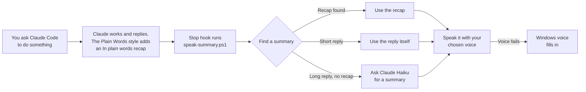

# Claude Code Voice Summary

**Hear what Claude Code just did, in plain words.**

Claude Code writes long, technical replies. If you're building something but you aren't a programmer, reading every reply takes time, and much of it is jargon. This add-on fixes that:

1. **Plain Words**: Claude Code keeps coding exactly as before, but ends every reply with a short **"In plain words"** recap anyone can understand.
2. **Voice**: after each reply, that recap is **read aloud** through your speakers or headphones. You can look away, listen, and only read the full reply when you need to.

> *"The login page no longer logs you out after a few minutes. Nothing needed from you right now. Next, I'll tidy up the sign-up page."*
> (an example of what you'd hear)

Choose from four voices, including **Kokoro**, a free, open-source voice that sounds natural and runs entirely on your own PC.

<!-- Tip: add a short demo GIF or video here -->

---

## Contents

- [Who it's for](#who-its-for)
- [Requirements](#requirements)
- [Install in 5 minutes](#install-in-5-minutes)
- [Choosing a voice](#choosing-a-voice)
- [Everyday use](#everyday-use)
- [How it works](#how-it-works)
- [Privacy and cost](#privacy-and-cost)
- [Customising](#customising)
- [Troubleshooting](#troubleshooting)
- [Uninstall](#uninstall)
- [Limitations](#limitations)
- [Credits and licences](#credits-and-licences)

---

## Who it's for

- People building apps or websites with Claude Code **without a programming background**: scientists, founders, designers, students.
- Programmers who want a **spoken heads-up** when a long task finishes, without watching the screen.
- Anyone who'd rather **listen than read** while Claude works.

## Requirements

| You need | Notes |
|---|---|
| **Windows 10 or 11** | Mac and Linux aren't supported yet (see [Limitations](#limitations)). |
| **Claude Code** | Works with the Claude Code desktop app, terminal or editor extension. |
| Speakers or headphones | |
| *Optional:* Python 3.10–3.13 | Only for the free Kokoro voice. The setup can install it for you. |
| *Optional:* an OpenAI or Azure key | Only if you choose one of those voices. |

## Install in 5 minutes

1. **Download.** On this page, click the green **Code** button, then **Download ZIP**. (Or download the zip from the [Releases](../../releases) page.)
2. **Unzip** it anywhere, for example on your Desktop.
3. **Double-click `install.bat`.**
   - If Windows shows *"Windows protected your PC"*, click **More info**, then **Run anyway**. This appears for any script downloaded from the internet.
   - You should hear *"Voice summaries are ready."*
4. When asked **"Would you like to choose a more natural voice now?"**, type **Y** and follow the prompts (see [Choosing a voice](#choosing-a-voice)). You can also skip this and do it later.
5. **Close Claude Code completely and open it again.**

That's it. From now on, each time Claude Code finishes a reply, you'll hear a short summary.

> Running `install.bat` again is safe. It updates the files and keeps your settings.

## Choosing a voice

Double-click **`choose-voice.bat`** at any time. You pick a voice, hear a sample, and keep the one you like.

| Voice | Sounds | Cost | Privacy | Setup |
|---|---|---|---|---|
| **Kokoro** *(recommended free option)* | Natural and warm. American and British English. | **Free** | Runs **on your PC**. Nothing leaves your computer. | One-time download of about 400 MB. Each summary starts a few seconds after Claude finishes. |
| **OpenAI** | Very natural. Choose a tone (warm, upbeat or calm) and one of 8 voices. | Pay as you go, roughly half a US cent per summary. | Summary text is sent to OpenAI. | Needs an API key from [platform.openai.com](https://platform.openai.com) → API keys. You may need to add prepaid credit under Billing. |
| **Microsoft Azure** | Natural. Includes Indian, American and British English. | Free tier: 500,000 characters a month (over 1,000 summaries). | Summary text is sent to Microsoft. | Needs a Speech resource on the **Free F0** tier: [portal.azure.com](https://portal.azure.com) → Create a resource → Speech → Keys and Endpoint. Copy **KEY 1** and the **Region**. |
| **Windows built-in** | Robotic | Free | On your PC | Nothing to set up |

**If a voice fails** (no internet, no credit, a wrong key), the Windows voice fills in automatically, so you never miss a summary. The reason is written to the [log file](#troubleshooting).

### About the Kokoro setup

The first time you pick Kokoro, `choose-voice.bat` sets it up for you (about 5–15 minutes):

1. It looks for Python 3.10–3.13. If none is found, it offers to install Python 3.12 for your user account using Windows' built-in `winget`.
2. It creates a private Python environment in `%USERPROFILE%\.claude\kokoro`.
3. It installs the [`kokoro-onnx`](https://github.com/thewh1teagle/kokoro-onnx) package.
4. It downloads the Kokoro model (325 MB) and voices (28 MB).
5. It runs a quick test.

Kokoro voices offered: **Heart, Bella, Nicole** (American, female), **Michael, Puck, Fenrir** (American, male), **Emma** (British, female), **George, Fable** (British, male).

## Everyday use

| To... | Do this |
|---|---|
| Mute the voice | Type `/voice-off` in Claude Code |
| Unmute | Type `/voice-on` |
| Change the voice, tone or speed | Double-click `choose-voice.bat` |
| Re-read the last summary | Open `%USERPROFILE%\.claude\last-summary.txt` |
| Stop the "In plain words" recap (keep the voice) | Type `/output-style default` |
| Turn the recap back on | Type `/config`, choose **Output style**, then **Plain Words** |
| Reply by voice | Use Windows dictation (**Windows key + H**) or a dictation app in the Claude Code message box |

## How it works

The add-on uses three built-in Claude Code features:

1. **[Output style](https://code.claude.com/docs/en/output-styles)** (`plain-words.md`): a standing instruction that changes how Claude writes. It keeps Claude's normal coding behaviour and adds the plain-words recap at the end of every reply.
2. **[Hook](https://code.claude.com/docs/en/hooks)** (`speak-summary.ps1`): a small script Claude Code runs automatically when it finishes a reply (the `Stop` event). It runs in the background, so Claude Code never waits for it.
   - The script reads the recap if there is one.
   - For a short reply with no recap, it reads the reply itself.
   - For a long reply with no recap, it asks Claude Haiku for a quick summary using the `claude` command, if installed.
   - As a last resort, it reads the first couple of sentences.
   - Only one summary plays at a time.
3. **[Skills](https://code.claude.com/docs/en/skills)** (`/voice-off`, `/voice-on`): mute and unmute by creating or deleting a small marker file.

### What gets installed where

Everything lives in your user's Claude Code folder, `%USERPROFILE%\.claude\`:

| Location | What it is |
|---|---|
| `settings.json` | Gets one `Stop` hook entry and `"outputStyle": "Plain Words"`. Your other settings are kept, and a backup is saved next to it first (`settings.json.backup-<date>`). |
| `output-styles\plain-words.md` | The Plain Words style |
| `hooks\speak-summary.ps1` | The hook script |
| `hooks\voice-engines.ps1` | Shared voice code (Kokoro, OpenAI, Azure, Windows) |
| `hooks\choose-voice.ps1`, `hooks\setup-kokoro.ps1`, `hooks\kokoro-speak.py` | Voice picker and Kokoro helper |
| `hooks\voice-config.json` | Your voice choice (created by `choose-voice.bat`) |
| `skills\voice-on\`, `skills\voice-off\` | The mute and unmute commands |
| `kokoro\` | Kokoro's private Python environment and model, if you chose Kokoro |

## Privacy and cost

- **Kokoro and Windows voices** run entirely on your PC. The summary text never leaves your computer.
- **OpenAI or Azure voices** send only the short summary text (not your code or the full reply) to that service to be turned into speech. Their own privacy terms apply.
- **API keys** are stored encrypted with Windows' per-user protection (DPAPI), so only your Windows account can read them. They are never written to the log.
- **The Haiku fallback** runs only when a reply has no recap, which is rare with the Plain Words style on. It uses your own Claude Code login, so it counts toward your normal Claude usage.

## Customising

**Tailor the recap to you.** Open `%USERPROFILE%\.claude\output-styles\plain-words.md` in Notepad. At the top, add a line about yourself, for example *"They are a biologist, so lab comparisons work well."* Save the file and restart Claude Code.

**Change the recap length or tone.** In the same file, edit the rules under *"End every reply with a plain-words recap"*.

**Change the Haiku summary instructions.** Edit the text near the top of `%USERPROFILE%\.claude\hooks\speak-summary.ps1`.

## Troubleshooting

**Where's the log?** Problems are written to `%USERPROFILE%\.claude\hooks\voice-summary.log`. Open it in Notepad. It usually says exactly what went wrong.

| Problem | Fix |
|---|---|
| No sound at all | Check your headphones are the default output in Windows sound settings, then run `install.bat` again to hear the test sound. Make sure you restarted Claude Code after installing. |
| Still nothing after restarting | In Claude Code, type `/hooks` and check that a `Stop` hook mentioning `speak-summary.ps1` is listed. If not, run `install.bat` again. |
| Installer says *"Could not find the claude command"* | This is only a note, not an error: the voice works without it. It's only needed for the rare reply with no recap. To add it, paste `irm https://claude.ai/install.ps1 \| iex` into PowerShell. |
| It uses the robotic voice even though I picked another | Your chosen voice failed and the Windows voice filled in. The log says why, for example a wrong key, no credit or no internet. Run `choose-voice.bat` to fix it. |
| Kokoro setup can't find Python | Install Python 3.12 from [python.org](https://www.python.org/downloads/) and tick **"Add python.exe to PATH"**. Then run `choose-voice.bat` again. |
| Kokoro takes long to start speaking | Kokoro runs on your own processor. Slower PCs need a few seconds per sentence. It starts speaking after the first sentence is ready. |
| Azure error *"Subscription frozen due to inactivity"* | Your old Azure subscription is locked. Create a new Pay-As-You-Go subscription (the Free F0 Speech tier still costs nothing), ask Microsoft Support to unfreeze it, or use Kokoro instead. |
| *"Windows protected your PC"* | Click **More info**, then **Run anyway**. |

## Uninstall

Double-click **`uninstall.bat`**, then restart Claude Code. It removes the hook, the style, the commands, your voice settings and the Kokoro files, and leaves the rest of your Claude Code settings as they were. A backup of your settings is saved first.

## Limitations

- **Windows only for now.** The scripts use PowerShell and Windows' speech and audio features. A Mac or Linux version would be a welcome contribution (macOS has a built-in `say` command).
- You hear a summary **each time Claude stops**, not after every small step inside a long task.
- Kokoro's offline voices are **English only** in this version (American and British).
- This is a community project. It is **not affiliated with or endorsed by Anthropic**.

## Contributing

Issues and pull requests are welcome, especially:

- macOS and Linux support
- more Kokoro languages
- other free voice engines (for example Piper)

## Credits and licences

- **This project**: [MIT License](LICENSE).
- **[Kokoro-82M](https://huggingface.co/hexgrad/Kokoro-82M)** voice model by hexgrad: Apache 2.0. Downloaded at setup, not included in this repository.
- **[kokoro-onnx](https://github.com/thewh1teagle/kokoro-onnx)** by thewh1teagle: MIT. Installed at setup.
- Kokoro uses **[espeak-ng](https://github.com/espeak-ng/espeak-ng)** (GPL-3.0) for pronunciation. It is installed automatically with kokoro-onnx and is not included in this repository.
- Built with [Claude Code](https://code.claude.com/docs) hooks, output styles and skills.
